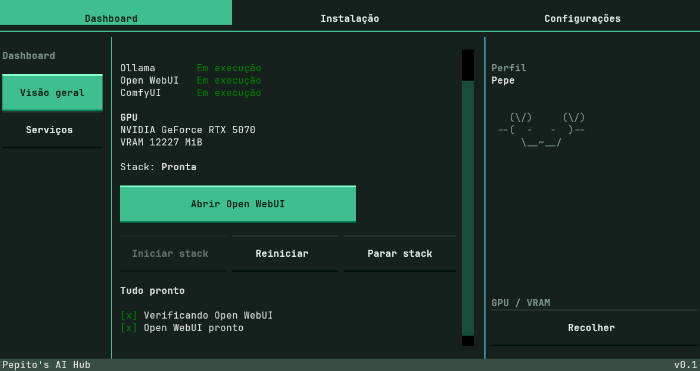
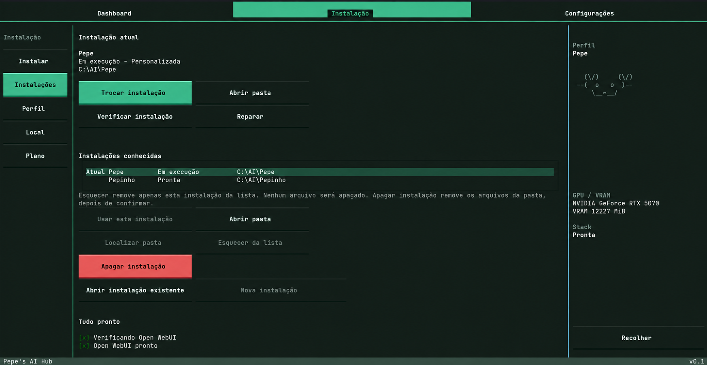

# Pepe's AI Hub

Hub local para instalar e gerenciar uma stack de IA local: Ollama, Open WebUI e ComfyUI.

## O que é

Uma aplicação para Windows que cria, opera e mantém instalações locais de IA a partir de uma interface única.

- instala e gerencia **Ollama**, **Open WebUI** e **ComfyUI**
- configura cada instalação a partir de um perfil pronto
- permite ter mais de uma instalação e alternar entre elas
- interface em **PT-BR**

## Recursos atuais

- criação e gerenciamento de instalações
- troca entre instalações
- exclusão / desinstalação de instalações
- perfis prontos para diferentes níveis de hardware
- iniciar, parar e reiniciar a stack
- abrir o Open WebUI pelo Hub
- verificação e reparo da instalação
- chat local
- geração de imagem
- edição de imagem

## Screenshots

### Dashboard

Instalação atual, estado dos serviços e ações principais.

### Instalações

Instalações conhecidas, troca de instalação e manutenção.

## Perfis disponíveis

| Perfil | Faixa | Validação |
| --- | --- | --- |
| **Pepinho** | 8 GB | orçamento de 8 GB validado; ainda não testado em GPU física de 8 GB |
| **Pepe** | 12 GB | validado em RTX 5070 real |
| **Capella** | 32 GB | pronto no código; validação em RTX 5090 física pendente |

Os recursos disponíveis (chat, geração e edição de imagem) e os modelos usados dependem do perfil.

## Coming next

Épicos e frentes do backlog, sem data definida:

- nova UI / UX
- expansão da biblioteca de modelos
- melhorias de tool calling
- atualização gerenciada do Open WebUI
- atualização automática do Hub
- melhor empacotamento da aplicação
- assinatura de código
- validação em mais configurações de hardware
- melhorias de qualidade de vida baseadas em feedback

## Status

**v0.1.0-rc1** — pré-versão destinada a testes. Download na página de [Releases](https://github.com/Pepepop0/pepes-ai-hub/releases).
