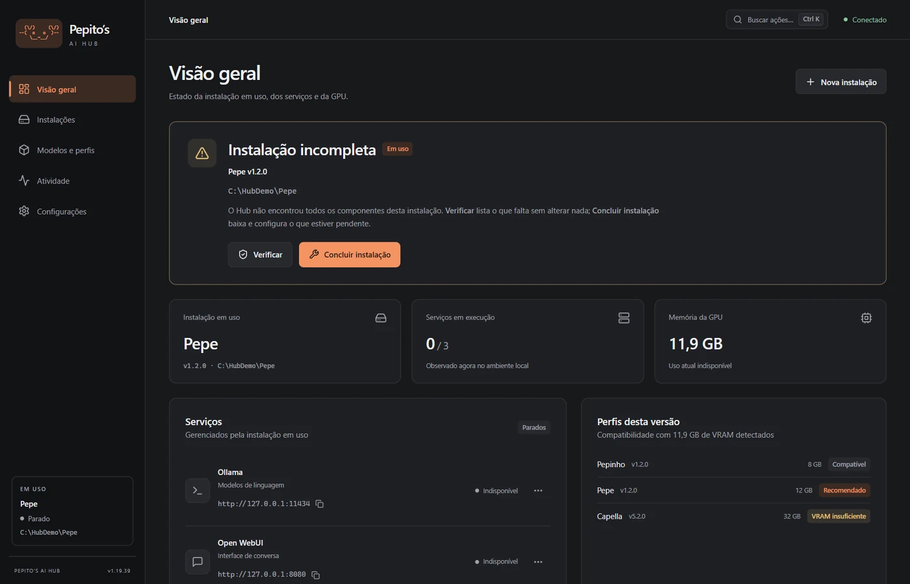
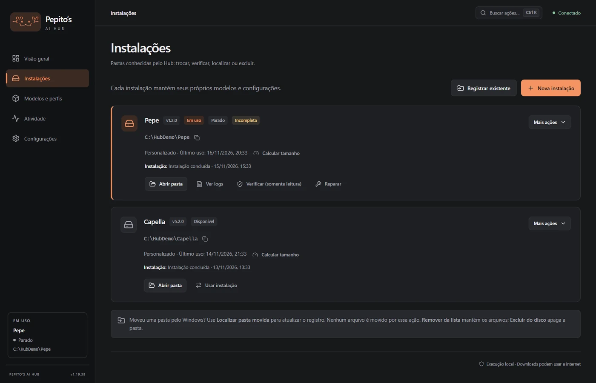
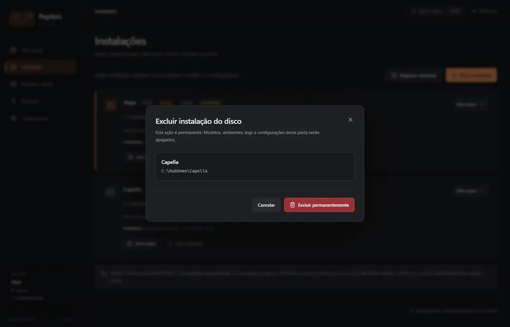
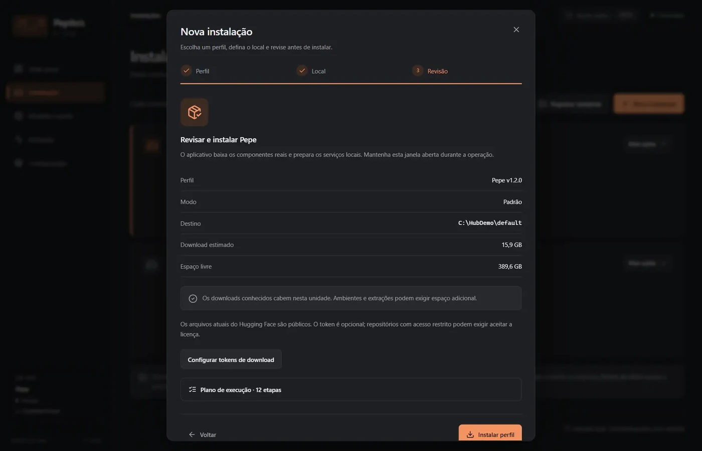
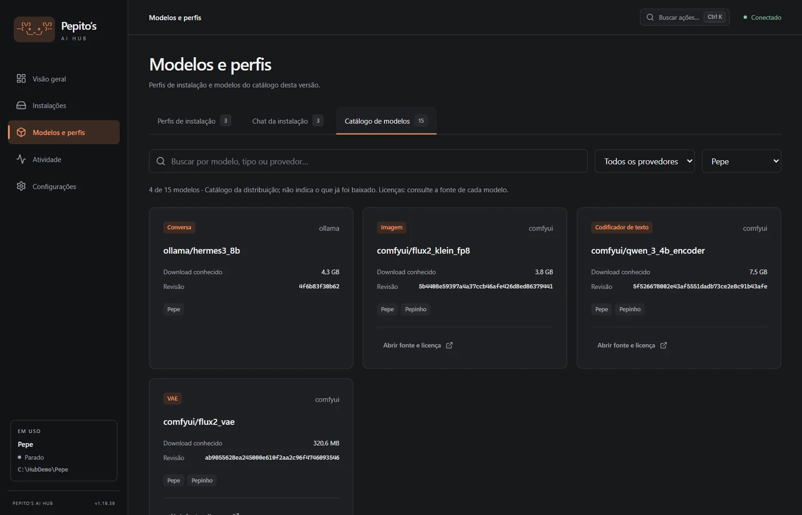
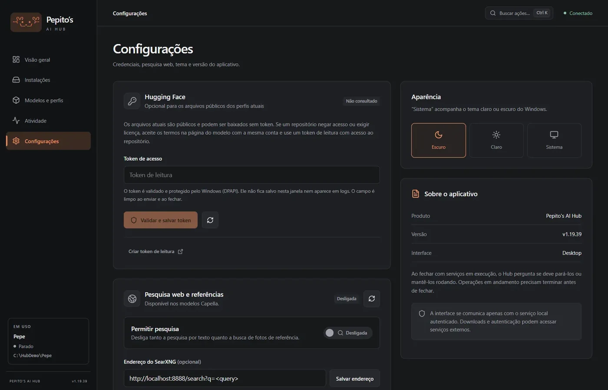
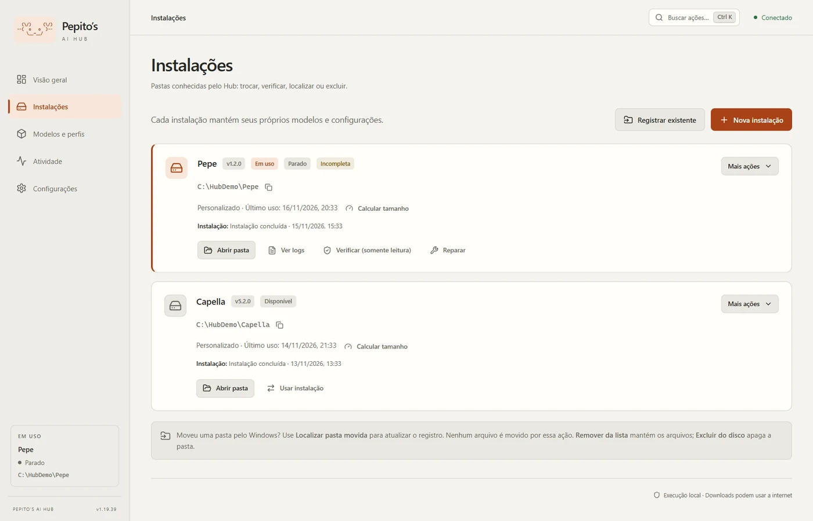
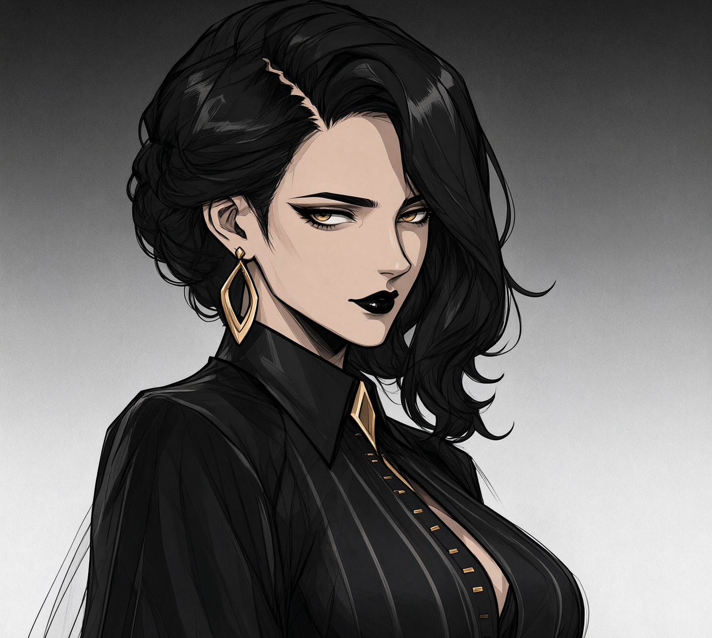

# Pepe's AI Hub

Hub local para instalar e gerenciar uma stack de IA local: **Ollama**, **Open WebUI** e **ComfyUI**, com chat, geração e edição de imagem.

Versão **1.19.39** (filtro de imagem 0.29). Licença [MIT](LICENSE); componentes e modelos de terceiros em [THIRD_PARTY_NOTICES.md](THIRD_PARTY_NOTICES.md). Histórico em [CHANGELOG.md](CHANGELOG.md).

## O que é

Uma aplicação desktop para Windows que cria, opera e mantém instalações locais de IA a partir de uma janela única (React + shadcn/ui em WebView2, motor Python). O Hub também oferece uma **bancada Linux x86-64 por CLI/SSH** (perfis Capella, Pepe e Pepinho), usada em pods alugados: não é uma janela remota; o Open WebUI é acessado por túnel no navegador local.

- instala e gerencia **Ollama**, **Open WebUI** e **ComfyUI**
- configura cada instalação a partir de um perfil pronto
- permite ter mais de uma instalação e alternar entre elas
- interface em **PT-BR**, tema escuro, claro ou do sistema

## Perfis

| Perfil | Hardware | Chat | Imagem | Validação |
| --- | --- | --- | --- | --- |
| **Pepinho** (`pepe-8gb`) | Windows, GPU NVIDIA de 8 GB | Hermes 3 3B | FLUX.2 klein 4B | orçamento de 8 GB validado; ainda não testado em GPU física de 8 GB |
| **Pepe** (`pepe`) | Windows, RTX 5070 (12 GB) | Hermes 3 8B | FLUX.2 klein 4B | validado em RTX 5070 real |
| **Capella** (`capella`, v5.2.0) | Linux/pod com RTX 5090 (32 GB) | Qwen3.8 27B Q5_K_M (visão e ferramentas) | Qwen-Image 2.1, SAM 3.1 e Depth Anything 3 | testada em pods RTX 5090; validação do 1.19.39 pendente |

Os recursos disponíveis dependem do perfil. Na RTX 5090 o chat (27B) e os modelos de imagem não ficam residentes juntos: uma fila única de GPU descarrega o Ollama antes do ComfyUI e libera o ComfyUI antes da resposta do chat.

## O que o chat de imagem faz

No Open WebUI, o filtro de imagem do Hub entende o pedido em português ou inglês e escolhe a ação:

- **Gerar**: imagem nova a partir do texto, com formato (retrato, paisagem, quadrada, 9:16, 16:9) e quantidade ("gera 3") seguindo o pedido; estilo Fotorrealista ou Arte digital.
- **Editar**: muda cor, roupa, fundo, tamanho ou forma; remove objetos; trabalha sobre a imagem inteira ou só sobre uma área pintada na imagem, com até três referências (papéis A/B/C). O resto da imagem fica idêntico à origem.
- **Trocar personagem**: coloca outra personagem numa cena, com duas variações para você escolher.
- **Corrigir o tom**: depois de cada edição, o brilho e a cor fora da área editada voltam aos da imagem de origem, para a imagem não escurecer a cada passo.
- **Refinar**: "não mudou" refaz com mais liberdade; "mudou demais" refaz mais fiel; **Usar esta** e **Editar esta** escolhem a imagem atual; o painel de prompt e receita mostra como cada imagem foi feita e permite regerar com a mesma semente.
- **Buscar referências** (opcional): ao pedir algo específico (um carro, um lugar real), o chat procura uma foto licenciada na web e credita o autor; a busca nunca procura pessoas.

Editar fotos de pessoas reais exige consentimento, e a salvaguarda de idade vale para todos os perfis.

## Requisitos

- **Windows (Pepinho e Pepe):** Windows 10/11 x64, GPU NVIDIA, Git for Windows e Microsoft Edge WebView2 Runtime. Se o Git estiver ausente, a tela **Nova instalação** oferece instalação confirmada pelo `winget` e o [download manual oficial](https://git-scm.com/download/win). O pacote já inclui o aplicativo; Python e Node.js não são necessários no destino.
- **Linux/pod (Capella, Pepe e Pepinho):** Linux x86-64 com GPU NVIDIA (a Capella exige 32 GB, como a RTX 5090; Pepe 12 GB e Pepinho 8 GB também rodam nela), disco com folga para os modelos e acesso SSH. A máquina local precisa de `ssh`/`scp` e Python 3.11 ou mais novo.
- **Espaço:** reserve o tamanho do perfil escolhido; o assistente mostra o espaço necessário antes de instalar.

## Como abrir (Windows)

No checkout, depois do `bootstrap-dev.bat` uma vez: `run.bat`. No pacote: `PepitosAIHub.exe`. Detalhes em [BUILD_WINDOWS.md](BUILD_WINDOWS.md).

## Instalação no pod (Capella, Pepe, Pepinho)

1. Alugue um pod Linux com RTX 5090 e anote host, porta e um apelido (`--alias`). O perfil padrão é `capella`; use `--profile pepe` ou `--profile pepe-8gb` para os outros (o Civitai só é exigido pelos perfis que baixam de lá).
2. Gere o pacote Linux (`scripts/build_linux.py`), que produz `PepitosAIHub-Capella-v<versão>-linux-amd64.tar.gz`.
3. Instale e suba:

```bash
mkdir -p pod-session
python scripts/pod_session.py up --host H --port P --alias ID --out pod-session > pod-session/up.log 2>&1
# Outro perfil (dados em /mnt/pepitos-bench/pepe-data, sem misturar com a Capella):
#   python scripts/pod_session.py up --host H --port P --alias ID --profile pepe --out pod-session
python scripts/pod_session.py tunnel --out pod-session  # manter aberto; acessar http://127.0.0.1:18080
# Depois de criar a conta, em outro terminal:
python scripts/pod_session.py start --out pod-session
# Ao encerrar os testes:
python scripts/pod_session.py collect --out pod-session
```

4. Acompanhe a instalação ao vivo em outro terminal, lendo o log do `up` (somente leitura):

```bash
python scripts/pod_watch.py pod-session/up.log
```

O perfil escolhido fica em `pod-session/pod-state.json`; `tunnel`, `start`, `sync-filter` e `collect` o reaproveitam (ou aceitam `--profile`). `up` registra cada etapa e a pula se for executado de novo, então uma queda de conexão se retoma repetindo o comando. Receita completa em [docs/PLANO.md](docs/PLANO.md) (seção 9) e [runbook Linux](docs/testing/runbook-linux-1.17.md).

## Tokens e credenciais

- **Hugging Face** (recomendado): um token evita limites de download. Em **Configurações → Hugging Face** no Hub, ou `PepitosAIHub-CLI.exe --hf-login` / `--hf-status` / `--hf-logout`. No pod, o `pod_session.py` envia o token só pela entrada padrão do shell remoto e o oculta de tudo que imprime. Variável `HF_TOKEN` para automação.
- **Civitai**: não é necessário nos perfis públicos. Só crie um token se um perfil ou modelo seu pedir.
- **Pesquisa web** (opcional): DuckDuckGo, Wikimedia e Openverse funcionam sem chave; SearXNG, Brave, Unsplash e Pexels são opcionais (`BRAVE_SEARCH_API_KEY`, `PEPITO_UNSPLASH_KEY`, `PEPITO_PEXELS_KEY`).

No Windows o Hub protege as credenciais com o DPAPI do usuário atual e nunca as mostra de novo.

## Segurança e privacidade

- O link de convidado do pod deixa o cadastro aberto enquanto o túnel roda: qualquer pessoa com o link pode criar conta (SEC-02). Compartilhe só com quem confia e encerre o túnel ao terminar.
- A coleta de sessão (`collect`) inclui as conversas de todos os usuários do Open WebUI do pod; revise o conteúdo antes de compartilhar o pacote.
- Tokens seguem só pela entrada padrão (stdin), nunca na linha de comando nem em arquivos da sessão.

## Recursos do Hub

- criação guiada de instalações com compatibilidade, espaço e plano simulado
- troca entre instalações; abrir a pasta da instalação, de modelos e de logs
- cadastrar uma instalação existente e localizar uma pasta movida
- remover da lista (mantém arquivos) ou excluir do disco com uma confirmação
- iniciar, parar e reiniciar a stack; abrir o Open WebUI pelo Hub
- verificação (somente leitura) e reparo da instalação
- visualizador de logs dos serviços, com modo ao vivo
- andamento da instalação com etapa atual e tempo desde a última atualização; pausar, retomar e cancelar
- downloads retomáveis
- paleta de comandos (`Ctrl+K`) e atalhos de teclado (`?` mostra a lista)
- importador de modelos do Ollama ou GGUF do Hugging Face (**Modelos e perfis → Chat da instalação**)
- fechar o Hub pergunta se os serviços devem ser parados

Documentação: [PRD](docs/PRD.md), [PRD de instalações](docs/PRD_INSTALLATIONS.md), [arquitetura](docs/ARCHITECTURE.md), [planejamento](docs/ROADMAP.md), [versionamento](docs/VERSIONING.md), [build](BUILD_WINDOWS.md).

## Screenshots

Capturas da interface desktop (v1.19.39) com dados de demonstração: duas instalações fictícias (Pepe e Capella), a primeira incompleta e sem modelos baixados.

### Visão geral



### Instalações

Abrir pasta, ver logs, usar outra instalação, verificar (somente leitura), reparar, localizar pasta movida, remover da lista ou excluir do disco.





### Nova instalação



### Modelos e perfis

Catálogo filtrado pelo perfil Pepe.



### Configurações e tema claro





### Exemplos de imagens

**Arte digital** — exemplo de geração fornecido pelo autor:



**Edição em sequência, no mesmo chat.** O primeiro prompt gera a imagem; os dois seguintes editam a imagem anterior:

1. **Geração:** “Gere uma foto de uma mulher adulta de casaco vermelho numa praça.”

   

2. **Troca de cor:** “Deixe o casaco azul, mantendo o restante.”

   

3. **Novo elemento:** “Agora coloque um chapéu preto nela.”

   


## Desenvolvimento

```bash
python -m pip install -e ".[dev]"
ruff format --check
ruff check src tests scripts assets
pytest -q
```

A CI roda esses passos em Python 3.11 e 3.12.

## Em breve

Sem data definida: importação de modelos de imagem e addons declarativos de perfis, atualização do Open WebUI e do Hub pela interface, assinatura de código e validação em mais configurações de hardware.

## Status

**v1.19.39**: entrega de testes, ainda não validada em pod e sem release publicada. Resumo das mudanças em [CHANGELOG.md](CHANGELOG.md).
