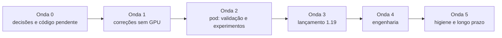
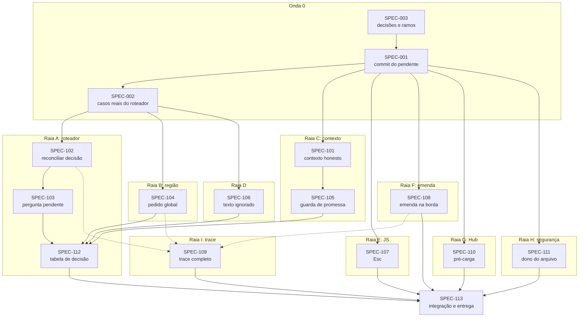
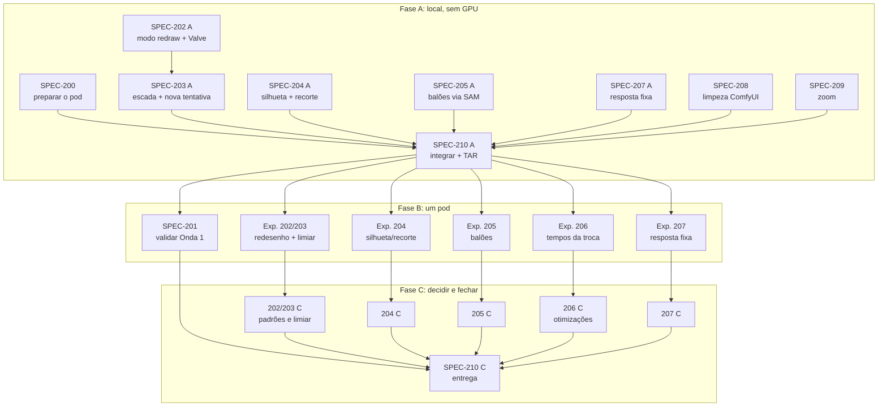
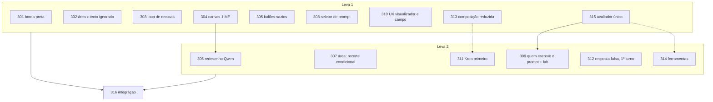

# Plano mestre — Pepito's AI Hub (a partir de 10/11/2026)

Este é o documento-guia dos próximos passos. Ele reúne **todas** as pendências conhecidas, as decisões já tomadas, as que faltam tomar e a ordem sugerida de trabalho.

- O detalhe técnico de cada item (evidência, causa, PRD completo) está em `docs/research/2026-11-10-problemas-e-debitos.md` (Rel. 1) e `docs/research/2026-11-10-revisao-geral.md` (Rel. 2).
- As specs executáveis das Ondas 0 e 1 (SDD) estão em `docs/specs/`, com o grafo de dependências na seção 13.
- Aqui fica o **o quê**, o **porquê**, a **prioridade** e o **critério de pronto**. Lá fica o **como**.
- Toda pendência tem um ID estável (ex.: `CHAT-01`). Use o ID para conversar sobre ela e para marcar progresso.

---

## Sumário

1. Como usar este documento
2. Estado atual
3. Regras de trabalho (não mudam)
4. Decisões já tomadas
5. Decisões que faltam (suas)
6. Inventário completo de pendências
7. Plano em ondas
8. Roteiro do próximo pod
9. Receita de pod
10. Guia de teste no chat
11. Onde estão os dados
12. Registro de mudanças deste documento
13. Desenvolvimento guiado por spec (SDD): Ondas 0 e 1
14. SDD: Onda 2 (pod de validação e experimentos)
15. SDD: Onda 3 (correções do pod de 12/11, decisões dos labs, seletor de prompt)

---

## 1. Como usar este documento

**Status possíveis:** `aberto`, `decidir` (espera decisão sua), `em andamento`, `feito sem pod` (pronto, falta validar com GPU), `validado`, `parado` (decisão consciente de não fazer agora), `descartado`.

**Prioridade:**

| Nível | Significado |
|---|---|
| **P0** | Quebra a experiência no uso normal ou bloqueia o lançamento da 1.19 |
| **P1** | Incomoda muito ou custa tempo em todo uso; resolver nesta versão se couber |
| **P2** | Melhora real, mas pode esperar a próxima versão |
| **P3** | Dívida ou melhoria de longo prazo |

**Esforço:** P = horas, M = 1 a 3 dias, G = uma semana ou mais.

**Pod?** "Sim" quando o item só pode ser feito ou validado com GPU (RTX 5090 alugada).

Ao fechar um item: mudar o status, anotar a data e o commit na coluna de status ou no fim da seção, e registrar na seção 12.

---

## 2. Estado atual

| Aspecto | Situação |
|---|---|
| Versão | Hub **1.19.39** (filtro 0.29), perfis Pepinho 1.2.0, Pepe 1.2.0 e Capella 5.2.0. Valor do C confirmado pelo dono em `docs/VERSIONING.md`. Não lançada |
| Distribuição | Versão **pública** (perfis Pepinho, Pepe e Capella, com licença MIT, `THIRD_PARTY_NOTICES.md`, `CHANGELOG.md` e CI) e um **pacote privado** (`packs/<nome>/`, só de arquivos novos, aplicado por `scripts/apply_pack.py`). O privado é "público + pacote"; o público não contém a pasta do pacote |
| Implementação atual | Filtro 0.29: troca com variação 1 Qwen inteira (caminho do LAB-04, sem colagem) e a segunda variação por composição; remoção de roupa pela edição geral; mudança de forma no Qwen; tom de cada edição devolvido à fonte. Monoimagem E/C e multirreferência V2/V3-E mantidas. Detalhes em `docs/ARCHITECTURE.md` |
| Entrega | Pacotes TAR e ZIP gerados com o nome `1.19.39` ainda por conferir. Sem push, tag ou lançamento sem ordem do dono |
| Suíte | Última rodada completa registrada (filtro 0.29, antes da separação público/privado): 4.741 passaram, 123 pulados, 2 falharam (testes da regeração da troca, depois atualizados e passando). A suíte da separação roda no fim do trabalho; o CI cobre Python 3.11 e 3.12 |
| Pods | Pod do LAB-04 liberado em 15/11 (136 imagens, 688 arquivos conferidos por SHA-256 no PC). Pods anteriores liberados |
| Funciona bem (não regredir) | Troca de personagem (85 a 252 s), edição por região automática no Qwen, edições de tamanho, restage, "tente de novo" após pedido recusado, geração nova |
| Próximos passos | 1) validação em pod RTX 5090 pelo `docs/testing/pod-fluxo-final.md` (bloco 12 para as correções) com o público e, separadamente, com o pacote privado; 2) corrigir o que o pod achar; 3) **publicação só com ordem do dono** (repositório, tag e release) |
| Bloqueios | A validação exige pod (a 5070 local não roda o 27B). Desde 12/11 a coleta traz o `webui.db` |

---

## 3. Regras de trabalho (não mudam)

- Respostas em português, diretas, com evidência; dizer o que foi e o que não foi testado.
- **Git:** nunca push, tag ou release sem pedido. Commit em `test/all-in-one` com `git add -- <arquivos>` (nunca `.serena/`), depois cherry-pick para `desktop-ui-shadcn`. Depois do cherry-pick, `git diff test/all-in-one desktop-ui-shadcn | git hash-object --stdin` deve dar `2549eab47a26d1fcd303ef26f749828ba7bc2b6e`.
- **Python:** `.venv/Scripts/python.exe`; `ruff format` + `ruff check` em `src tests scripts assets`. Nunca instalar pacotes na `.venv`. Compositor: `swap-venv` com `pytest --noconftest tests/test_swap_composite.py`.
- **Tokens** (Civitai e Hugging Face) só pelo stdin do ssh; nunca imprimir.
- **Imagens das sessões:** não abrir. Usar trace, logs, números e as imagens que você colar.
- **Pod:** antes de liberar, trazer trace, logs e imagens; tocar o som e escrever **PODE DELETAR O POD**.
- **Som nos marcos:** `powershell -NoProfile -Command '[System.Media.SystemSounds]::Exclamation.Play(); Start-Sleep -Milliseconds 800; [System.Media.SystemSounds]::Asterisk.Play(); Start-Sleep -Milliseconds 700'`

---

## 4. Decisões já tomadas

| Data | Decisão | Motivo |
|---|---|---|
| 07–08/11 | Compositor G2 aprovado para a troca de personagem (16 de 18 casos bons) | Melhor que F2 nos 8 resultados comparados |
| 08/11 | Composição roda dentro do Open WebUI; detecção (SAM 3.1, Depth Anything 3) no ComfyUI | O Open WebUI 0.12.0 tem numpy/OpenCV; o ComfyUI não tem OpenCV e o Hub não instala nós próprios |
| 08/11 | Q3 e Q4 ficam fora do critério da troca | Erro é conteúdo do modelo |
| 08/11 | Deslocamento do Qwen-Edit (redimensionamento para 1 MP) vira débito P3 | O G2 já compensa na composição |
| 09/11 | O planejador decide qual imagem é a cena | O roteador inverteu cena e personagem no pod |
| 09/11 | Gerar em tamanho reduzido e compor no tamanho original | Cena de 5,3 MP fazia o Krea duplicar a pessoa e o turno levar 7,5 min |
| 09/11 | "Refaça" após pedido recusado repete o pedido recusado | Pedido seu |
| 09/11 | Noite de 09/11: só trazer dados e listar, sem corrigir | Pedido seu |
| 10/11 | Discovery "como uma IA aprende a escrever bem": parado | "Não por agora" |
| 10/11 | Esta pesquisa foi só leitura; nenhum código alterado | Pedido seu |

---

## 5. Decisões que faltam (suas)

| ID | Pergunta | Opções | Minha sugestão | Status |
|---|---|---|---|---|
| DEC-01 | Por onde começar | Ver seção 7 | Onda 1 na ordem proposta | **aprovado 10/11** |
| DEC-02 | Formato do texto ignorado | `['...']` só; `[Ignorar: ...]` só; os dois | Os dois (você digitou `[Ignorar: ...]` na sessão) | **aprovado 10/11** |
| DEC-03 | "Harmonizar/refazer" parte de qual imagem | Imagem atual; primeira imagem da personagem | Atual | aberto (Onda 2, IMG-03) |
| DEC-04 | O que fazer com a pergunta `GLOBAL_EDIT_QUESTION` (sem commit) | Commitar; descartar e substituir pelo CHAT-04 | Substituir | **aprovado 10/11** |
| DEC-05 | Regra do balão `OVERLAY_REWRITTEN` (sem commit) | Commitar já; esperar SWAP-01 | Commitar (ganho pequeno, sem risco medido) | **aprovado 10/11** |
| DEC-06 | Touchpad no visualizador | Rolar = zoom (atual); rolar = deslocar, pinça = zoom | Atual | **aprovado 10/11** |
| DEC-07 | Resposta final dos turnos de imagem | Modelo de chat escreve (atual, +7 s); texto fixo | Testar texto fixo no pod e decidir com números | aberto (Onda 2) |
| DEC-08 | Pré-carregar o modelo de chat na subida | Sim (ocupa 20 GB parado); não | Sim, na Capella | **aprovado 10/11** |
| DEC-09 | Link de convidado: fechar cadastro sozinho | Após 1º convidado; após N minutos; manual | Após N minutos, configurável | aberto (Onda 3) |
| DEC-10 | Segunda rodada da revisão geral | Com subagentes quando o limite voltar; não fazer | Fazer | aberto |
| DEC-11 | Lançar a 1.19 | Depois da Onda 3 | — | aberto |
| DEC-12 | Manter dois ramos idênticos | Manter; unificar | Unificar depois do lançamento | aberto (afeta a integração da SPEC-113) |
| DEC-13 | Onde este documento vive | Pasta de relatórios; `docs/` do repositório | `docs/PLANO.md`, versionado | **aprovado 10/11** |
| DEC-14 | Zoom e fundo do visualizador (sem commit) entram no commit da Onda 0 sem sua conferência visual? | Sim, conferir no pod; não, esperar | Sim: a suíte passa e o JS da SPEC-107 mexe no mesmo arquivo | **aprovado 10/11** |

---

## 6. Inventário completo de pendências

Coluna **Origem**: número do item na lista dos 14 problemas, ou o ID dos relatórios (N1–N4 do Rel. 1; A/P/O/Q/D/S/R/H do Rel. 2).

### 6.1 Chat e roteador

| ID | Pendência | Origem | Prior. | Esf. | Pod? | Status |
|---|---|---|---|---|---|---|
| CHAT-01 | Modelo manda ligar o botão Imagem com ele ligado | item 1 | **P0** | M | Validar | validado no pod (12/11) |
| CHAT-02 | Roteador devolve `chat` com plano completo ou pergunta: o filtro descarta | item 1 | **P0** | (com CHAT-01) | Validar | validado no pod (12/11) |
| CHAT-03 | Resposta curta a uma pergunta do sistema ("a imagem toda", "Esta personagem") cai em `chat` | item 1 | **P0** | (com CHAT-01) | Validar | feito sem pod (10/11) |
| CHAT-04 | Pedido que muda a imagem toda é recusado ou vira pergunta | item 4 | **P0** | P | Validar | validado no pod (12/11) |
| CHAT-05 | Modelo escreve prompt em inglês e diz "me avise quando estiver pronto" | item 5 | P1 | P | Validar | feito sem pod (10/11) |
| CHAT-06 | Prompt de sistema da Capella fala do botão sem saber o estado; migrar instalações existentes | item 1 | P1 | P | Não | feito sem pod (10/11) |
| CHAT-07 | Texto entre `['...']` / `[Ignorar: ...]` não vai ao roteador nem ao modelo | item 7 | P1 | P | Não | validado no pod (12/11) |

**CHAT-01, 02 e 03 (causa confirmada):**
- O contexto `NO_IMAGE_CONTEXT` (`pepito_image_chat.py:153-159`) termina mandando o modelo pedir "com o Image ligado".
- Quando a ação é `chat`, o filtro ignora `plan.clarification` e um plano completo (`:7022-7031`).
- Não existe estado de "pergunta pendente" para respostas curtas.
- Três ocorrências: 09/11 01:35:14 e 01:58:25; 08/11 00:38:53.

**Solução:**
1. Reescrever `NO_IMAGE_CONTEXT`: "o Image está ligado, nunca peça para ligar".
2. Se vier `clarification`, responder com ela.
3. Se vier um plano completo com `action: chat`, promover para edição (com `source=promoted` no trace).
4. Generalizar o `PENDING_KEY` para qualquer pergunta do sistema.

**Pronto quando:** as mensagens reais da tabela do Rel. 1 (itens 1 e 5) dão o resultado esperado em teste local, e no pod são zero menções ao botão em 30 turnos com Image ligado.

**CHAT-04 (causa confirmada):** dois `raise` em `prepare_local_preservation` (`:4446-4449` e `:4475-4482`). Trocar por "segue na imagem toda". A recusa fica só quando o usuário **pintou** uma área e pede pose ou cena.
**Pronto quando:** as três mensagens da sessão (01:58:10, 02:00:09, 02:02:01) geram imagem no mesmo turno.

**CHAT-05:** estender a guarda que já acrescenta "Nenhuma imagem foi criada" para promessas de geração futura. Rede de proteção; a correção de fato é a do CHAT-01.

**CHAT-06:** trocar a frase do botão no `profiles/capella.yaml`. Migração: atualizar só se o texto salvo for idêntico ao semeado antes; texto editado pelo administrador não é tocado.

**CHAT-07:** função `strip_ignored` no começo do `_inlet`, aplicada também ao histórico. Mensagem só com trecho ignorado recebe resposta fixa ("Anotado."). O trecho continua no trace (`ignored_text`). Casos de teste no Rel. 1, item 7.

### 6.2 Edição de imagem

| ID | Pendência | Origem | Prior. | Esf. | Pod? | Status |
|---|---|---|---|---|---|---|
| IMG-01 | Degrau na borda das edições com máscara — **Fase 1** (emenda corrigida no pós-processo) | item 2 | **P0** | M | Validar | validado no pod (12/11) |
| IMG-02 | Degrau — **Fase 2** (silhueta pelo SAM + recorte com contexto) | item 2, N3 | P1 | M | Sim | aberto |
| IMG-03 | "Refaça", "mais realista", "harmonizar" repetem a imagem | item 3 | **P0** | M | Sim | decidir (DEC-03) |
| IMG-04 | Escada de "nada mudou" com troca de ferramenta e nova tentativa automática | item 3, N2 | P1 | M | Sim | aberto |
| IMG-05 | Semente sempre escolhida pelo filtro e registrada no trace | item 3 | P2 | P | Não | validado no pod (12/11) |
| IMG-06 | Degrau — **Fase 3** (amostragem com máscara no grafo do Krea) | item 2 | P3 | M | Sim | só se IMG-02 não bastar |
| IMG-07 | Q3/Q4 e texto duplicado no "de lado" | item 10 | P3 | — | — | parado (conteúdo do modelo) |

**IMG-01 (causa medida):**
- O Krea redesenha a imagem inteira: fora da máscara ela muda 21 a 28 níveis.
- Colamos só o miolo, e o salto na borda fica 1,9 a 2,6 vezes o natural. No Qwen não há degrau.
- A correção de tom do G2 (desvio medido no anel de fora, difundido para dentro, rampa só para dentro) volta ao natural: 33,9 → 12,2 e 21,7 → 12,3, com o lado de fora exato.

**Pronto quando:**
- degrau final ≤ 1,25 × degrau da origem;
- `outside_exact=true`;
- o miolo não muda mais que 2 níveis;
- o caso Qwen fica igual ao de hoje.

Novos campos no trace: `band_step_source`, `band_step_final`, `outer_ring_mad`.
**Limite:** a medição cobre o tom, não a continuidade de linhas. A Fase 2 cuida disso.

**IMG-03 (causa confirmada em parte; a semente foi descartada):**
- Pedidos de "refazer a imagem toda" vão para o adaptador de edição **local** (General Edit), com prompt "Keep unchanged: …".
- Baixar `ref_boost` até o piso (1,0) não mudou nada (diferença 3,6 → 3,6 → 2,7).

**Solução:**
- `edit_mode: "redraw"` no roteador;
- parte de redesenho (Qwen na Capella);
- prompt sem a lista "Keep unchanged" completa.

**Pronto quando:** as quatro mensagens do chat `09cd5d` dão diferença ≥ 15 na primeira tentativa e você confirma que virou foto.

**IMG-04:**
- Depois de `no_change`: mesma parte com `ref_boost` menor → parte de redesenho → geração nova.
- Reativar a medição `measured_change` como decisão (limiar inicial 6), com o aviso "Quase nada mudou; refazendo com mais liberdade".

### 6.3 Troca de personagem

| ID | Pendência | Origem | Prior. | Esf. | Pod? | Status |
|---|---|---|---|---|---|---|
| SWAP-01 | Palavras de balões reescritas ("rather", "Potter") | item 9 | P2 | M | Sim | aberto |
| SWAP-02 | Tempo da troca varia de 70 a 252 s; o trace não separa etapas | P4 | P1 | P (medir) | Sim | aberto |
| SWAP-03 | Qwen-Edit redimensiona para 1 MP (deslocamento) | item 12 | P3 | M | Sim | aberto (débito) |

**SWAP-01:** detectar texto e balões na cena original (SAM 3.1 com prompt textual, já instalado) e mantê-los da original, exceto onde a silhueta da personagem nova cobre (caso do chapéu).
**Pronto quando:** zero palavras alteradas fora da área coberta e nenhuma piora nos 16 casos aprovados.

**SWAP-02:**
- Primeiro, registrar no evento `swap_method` o tempo de geração, SAM, profundidade e composição.
- Depois: SAM e profundidade uma vez por cena, composição em resolução reduzida, ordem dos passes.

**SWAP-03:** ler `comfy_extras/nodes_qwen.py`; se o caminho de duas imagens redimensiona mesmo com `resolution: 0`, pré-escalar a cena para a grade exata do nó. Referências: ComfyUI issues #9481 e #10198.

### 6.4 Interface injetada no Open WebUI

| ID | Pendência | Origem | Prior. | Esf. | Pod? | Status |
|---|---|---|---|---|---|---|
| UI-01 | Esc desliga Imagem, filtros e ferramentas | item 6 | P1 | P | Não (Open WebUI aberto) | validado no pod (12/11) |
| UI-02 | Zoom com a roda e fundo do visualizador: sua conferência + 3 ajustes | item 8 | P2 | P | Não | commitado (c74dc25); falta sua conferência e os 3 ajustes |

**UI-01 (causa confirmada):** Open WebUI 0.12.0, `MessageInput.svelte:2217-2225`, zera tudo no Esc. Solução: ouvinte na fase de captura em `pepito_image_ui.js` que bloqueia o reset e mantém "Esc para parar a resposta" e "Esc fecha sugestões".
**Pronto quando:** Esc no campo mantém Imagem e Fotorrealista ligados, ainda para a resposta e ainda fecha o menu de sugestões.

**UI-02, ajustes:**
- ponto sob o cursor parado quando a imagem é menor que a área;
- normalizar `deltaMode` de linhas (Firefox);
- mencionar a roda no texto de ajuda.

### 6.5 Desempenho

| ID | Pendência | Origem | Prior. | Esf. | Pod? | Status |
|---|---|---|---|---|---|---|
| PERF-01 | Modelo de chat recarregado em todo turno de imagem só para uma frase (6,1 s de 27 s) | N1, P1 | P1 | M | Sim | reaberto: a resposta fixa (SPEC-207) não evita a chamada ao modelo; juntar com PERF-02 |
| PERF-02 | Roteador e resposta dos turnos de imagem num modelo pequeno, residente junto do modelo de imagem (também resolve PERF-01) | P2 | P1 | M | Sim | aberto (spec depois do pod) |
| PERF-03 | Carga fria de 41 a 57 s e descarga após 5 min parado | item 11, P3 | P1 | P | Validar | validado no pod (12/11) |
| PERF-04 | Opções de memória e cache do ComfyUI (manter codificador de texto em RAM) | Rel. 2 §2 | P3 | M | Sim | aberto (experimento) |
| PERF-05 | Instalar ambientes com `uv` em vez de `pip` | Rel. 2 §2 | P3 | M | Não | aberto |
| PERF-06 | Suíte leva 11 min em série; paralelizar (`pytest-xdist`) | Rel. 2, suíte | P2 | P–M | Não | aberto |

**PERF-03:** requisição vazia ao Ollama na subida, com o `num_ctx` do perfil (16384), e `keep_alive` longo. **Pronto quando:** o primeiro turno depois de "Iniciar" tem roteador abaixo de 12 s.

**PERF-01, números do turno típico:** roteador 6,3 s + job 12,5 a 14,6 s + recarga do chat e frase 7 s = 27,4 s.

### 6.6 Observabilidade

| ID | Pendência | Origem | Prior. | Esf. | Pod? | Status |
|---|---|---|---|---|---|---|
| OBS-01 | Trace sem semente efetiva, texto da resposta do chat, tempo por etapa, id do prompt e arquivo de saída do ComfyUI, métricas de emenda, `measured_change` | O1 | P1 | P | Não | validado no pod (12/11) |
| OBS-02 | Trazer o `webui.db` em toda coleta de sessão | bloqueio | P1 | P | — | aberto (receita, seção 9) |
| OBS-03 | Capturas amplas de exceção sem registro (84 `BLE001`, 8 `S110`) | Q5 | P2 | M | Não | aberto |

### 6.7 Segurança

| ID | Pendência | Origem | Prior. | Esf. | Pod? | Status |
|---|---|---|---|---|---|---|
| SEC-01 | `picture_bytes` / `replace_picture` leem e gravam arquivo por id sem checar o dono | N4, S1 | P2 | P | Não | feito sem pod (10/11) |
| SEC-02 | Link de convidado: cadastro aberto enquanto o túnel roda | S2 | P2 | P | Validar | decidir (DEC-09) |
| SEC-03 | Trace grava pedidos em texto; num pod com convidado, o dono lê tudo | S3 | P2 | P | Não | aberto |
| SEC-04 | Auditoria não feita: downloads e hashes dos manifestos, `pip` sem hashes, exclusão (junções e links), exportação de sessão, HTML injetado, salvaguarda de idade, SSRF na busca de referências, `test_api`, 17 `urlopen` e 1 `tarfile` sem filtro | Rel. 2 §6 | P1 | M | Não | aberto (segunda rodada) |

### 6.8 Robustez do pipeline

| ID | Pendência | Origem | Prior. | Esf. | Pod? | Status |
|---|---|---|---|---|---|---|
| ROB-01 | Entradas e saídas do ComfyUI nunca são limpas (77 MB + 42 MB por hora de sessão) | R1 | P2 | P | Validar | aberto |
| ROB-02 | Registros JSON por chat com leitura-modificação-escrita sem trava; `_results_path(...).write_text` não atômico (`:5338`) | Rel. 2 §7 | P3 | P | Não | aberto |
| ROB-03 | Teste que importa cada símbolo interno do Open WebUI usado pelo filtro e cada id do DOM usado pelo JS | Rel. 2 §7 | P2 | P | Não | aberto |
| ROB-04 | Estado em variáveis de módulo e trava da GPU por processo: registrar como premissa (um worker do Open WebUI) | R2 | P3 | P | Não | aberto (documentar) |

### 6.9 Arquitetura e qualidade de código

| ID | Pendência | Origem | Prior. | Esf. | Pod? | Status |
|---|---|---|---|---|---|---|
| ARQ-01 | Tabela de decisão testada para `_routed`, com as respostas reais do roteador do trace | A1 | P1 | M | Não | feito sem pod (10/11) |
| ARQ-02 | Dividir `_routed` (377 instruções, complexidade 110) em etapas puras | A1 | P2 | G | Não | depende de ARQ-01 |
| ARQ-03 | Dividir `pepito_image_chat.py` (7.906 linhas) em `pepito_trace`, `pepito_vram`, `pepito_router`, `pepito_safeguard`, `pepito_plan` | A2 | P2 | G | Não | aberto |
| ARQ-04 | Outras 80 funções com complexidade acima de 10 (`desktop/api.py:_execute` 68, `smoke_report`, `verify_session_archive`…) | A1 | P3 | G | Não | aberto |
| ARQ-05 | Duplicação entre `scripts/swap_composite.py` e `pepito_swap_compose.py` | Rel. 2 §1 | P3 | P | Não | aberto |
| ARQ-06 | `e2e/`, `test_api/` e TUI dentro do pacote do produto | Q6 | P3 | P | Não | aberto |

**ARQ-01 vem antes de qualquer outra mudança grande no filtro:** três dos problemas desta lista nasceram de combinações de ramos do `_routed`.

### 6.10 Testes, build e ferramentas

| ID | Pendência | Origem | Prior. | Esf. | Pod? | Status |
|---|---|---|---|---|---|---|
| QA-01 | Sem integração contínua (ruff, pytest, build do frontend) | Q1 | P2 | P | Não | aberto |
| QA-02 | Dependências Python sem trava (`uv lock` ou `pip-compile --generate-hashes`) | Q2 | P2 | P | Não | aberto |
| QA-03 | mypy: 225 erros em 42 arquivos; começar por `desktop/` (`agent.py:198`, `__init__.py:201` podem ser defeitos reais) | Q3 | P2 | M | Não | aberto |
| QA-04 | JS injetado (1.464 linhas) e frontend React sem testes de comportamento (Playwright) | Q4 | P2 | M | Não | aberto |
| QA-05 | 85 testes pulados: caminho nativo (`pepito_native.py`) não roda na suíte do dia a dia | Rel. 2, suíte | P2 | P | Não | aberto |
| QA-06 | Sem cobertura medida | Rel. 2, suíte | P3 | P | Não | aberto |
| QA-07 | Testes intermitentes: um de painel (09/11) e um erro de limpeza de pasta temporária que apareceu 2 vezes em 10/11 nos testes do filtro e sumiu ao repetir | sessões 09–10/11 | P3 | P | Não | aberto |
| QA-08 | `Image.getdata` obsoleto no Pillow 14 (2 testes) | Rel. 2, suíte | P3 | P | Não | aberto |
| QA-09 | `npm audit`: 1 vulnerabilidade moderada no frontend | Q4 | P3 | P | Não | aberto |
| QA-10 | Segunda rodada da revisão: núcleo do Hub de ponta a ponta, segurança (SEC-04), `capella-linux.sh` e `posix_runtime.py`, acessibilidade do frontend, tempos das outras sessões, referências externas com fonte | Rel. 2 §12 | P2 | G | Não | decidir (DEC-10) |
| QA-11 | Arquivos de teste nomeados por onda (`test_delivery_wave_a.py`, `test_final_v0_ux.py`, `test_desktop_qol.py`) | Rel. 2 §4 | P3 | P | Não | aberto |

### 6.11 Documentação

| ID | Pendência | Origem | Prior. | Esf. | Pod? | Status |
|---|---|---|---|---|---|---|
| DOC-01 | Quatro versões do perfil Capella nos documentos (5.0.0, 5.1.0, 5.1.1; real 5.2.0) | D1 | P1 | P | Não | aberto |
| DOC-02 | Checklist da Capella descreve a nova tentativa automática que não existe mais (`capella-5090-checklist.md:184-186`) | D3, N2 | P1 | P | Não | aberto (ou resolver com IMG-04) |
| DOC-03 | Documentos possivelmente órfãos (`NIGHT_ONE_PLAN`, `OPEN_QUESTIONS`, `SPEC`, `TEST_PLAN`, `POST_MVP_TEST_PHASE`, `CURRENT_STATE` de 12/10) | D2 | P3 | P | Não | aberto |
| DOC-04 | Atualizar o registro do swap-lab (material do pacote privado) com o teste final de 09/11 | sessão 09/11 | P1 | P | Não | aberto |
| DOC-05 | Atualizar `ARCHITECTURE.md` e `image-tool-chat.md` com as mudanças da Onda 1 | — | P1 | P | Não | aberto |

### 6.12 Repositório e higiene

| ID | Pendência | Origem | Prior. | Esf. | Pod? | Status |
|---|---|---|---|---|---|---|
| REPO-01 | 24 ramos locais e 8 worktrees, vários já integrados | H1 | P3 | P | Não | aberto |
| REPO-02 | Dois ramos mantidos idênticos por cherry-pick | H2 | P3 | P | Não | decidir (DEC-12) |
| REPO-03 | `dist/` com 43 artefatos (749 MB) | H1 | P3 | P | Não | aberto |
| REPO-04 | `capella_ai_config.yaml` rastreado e vazio; `prompts/` e `experiments/` no topo | H1 | P3 | P | Não | aberto |
| REPO-05 | Temporários em `%TEMP%`: `repro.py`, `repro/`, `sess.txt`, `sess2.txt`, `pod-final.log`, `pod-resume.log`, `degrau_medir.py`, `owui/`, `suite-medida.txt` | — | P3 | P | Não | aberto (apagar quando os números não forem mais necessários) |

### 6.13 Lançamento da 1.19

| ID | Pendência | Origem | Prior. | Esf. | Pod? | Status |
|---|---|---|---|---|---|---|
| REL-01 | Decidir o destino do código sem commit (DEC-04, DEC-05, UI-02) | item 14 | **P0** | P | Não | feito sem pod (10/11) |
| REL-02 | Commit nos dois ramos, conferir o hash | item 14 | **P0** | P | Não | feito sem pod (10/11) |
| REL-03 | Refazer o TAR (`scripts/build_linux.py`) e o ZIP do Windows | — | **P0** | P | Não | aberto |
| REL-04 | Validar a 1.19 com GPU e link de convidado | item 13 | **P0** | M | Sim | aberto |
| REL-05 | Decidir o lançamento (versão segue 1.19.0; sem tag ou push sem pedido) | item 13 | **P0** | — | — | decidir (DEC-11) |

### 6.14 Produto e longo prazo

| ID | Pendência | Origem | Prior. | Status |
|---|---|---|---|---|
| PROD-01 | Discovery: como uma IA aprende a escrever bem (prompt de sistema e temperatura, trocar o modelo de chat, filtro de frases repetitivas, ajuste fino no estilo POLARIS) | `PENDENCIAS.md` | P3 | parado |
| PROD-02 | Itens do `docs/ROADMAP.md` (backup e restauração, inventário de modelos, addons declarativos, cancelamento seguro, atualização do Open WebUI, assinatura de releases, cache de modelos compartilhado como no Stability Matrix) | ROADMAP | P3 | aberto (fora desta versão) |
| PROD-03 | Conferência por visão depois da geração (pessoa duplicada, texto repetido) com nova tentativa | item 10 | P3 | parado |

---

### 6.15 Achados do pod de 12/11 (detalhe em material do pacote privado)

| ID | Pendência | Origem | Prior. | Esf. | Pod? | Status |
|---|---|---|---|---|---|---|
| IMG-08 | Borda preta nas edições do Qwen: canvas múltiplo de 32 muda a proporção > 3% e o preenchimento transparente sai preto | P1 | **P0** | P | Validar | implementado localmente (Onda 3); falta pod |
| CHAT-08 | Área pintada recusada quando a mensagem tem `[‘...‘]`: o JS arma com o texto inteiro, o filtro compara sem o trecho; a área recusada bloqueia a mensagem seguinte | P2 | **P0** | P | Não | implementado localmente (Onda 3); falta pod |
| CHAT-09 | Loop "o plano não explicou o que usar de cada referência": retry junta propósitos (239–246 > 160); a pergunta pendente repete a recusa | P3, P5 | **P0** | P | Não | implementado localmente (Onda 3); falta pod |
| CHAT-10 | Redraw com base fora das referências recusado ("não incluiu a imagem") | P4 | P1 | P | Não | implementado localmente (Onda 3); falta pod |
| CHAT-11 | Depois de duas recusas iguais, tentar com padrões ou dizer o que falhou | P5 | P1 | P | Não | implementado localmente (Onda 3); falta pod |
| IMG-09 | Canvas do restage/redraw com os pixels da fonte (560×848 ≈ 0,47 MP): mínimo de 1 MP | P6 | **P0** | P | Validar | implementado localmente (Onda 3); falta pod |
| IMG-10 | Redesenho não troca o estilo (fotorrealista continua desenho): escolher a parte pelo lab 202 | P6 | **P0** | M | Sim | implementado localmente (Onda 3); falta pod |
| IMG-11 | Restage usa a imagem inteira como identidade: vaza roupa/logo de outras pessoas e objetos; estilo da edição sem o slider de foto [a conferir] | P7 | P1 | M | Validar | aberto |
| CHAT-12 | Localizador `ambiguous` com uma pessoa só: seguir na imagem toda | P8 | P1 | P | Não | implementado localmente (Onda 3); falta pod |
| IMG-12 | Edição por área: seleção pequena demais para a mudança solicitada | P9 | P1 | M | Sim | recorte condicional implementado; corte estrutural segue em IMG-13 |
| SWAP-04 | Composição da troca em resolução reduzida (83 s por método na cena de 5,3 MP) | P10 | P1 | M | Validar | implementado localmente (Onda 3); falta pod |
| PERF-07 | Primeiro turno 32 s com o modelo residente: pré-carga gerar 1 token | P12 | P2 | P | Validar | implementado localmente (Onda 3); falta pod |
| CHAT-13 | Resposta que afirma imagem sem imagem: trocar a resposta, não só acrescentar nota | P13 | P2 | P | Não | implementado localmente (Onda 3); falta pod |
| SWAP-05 | Detecção de balões quebra em cena sem balão (`SaveImage` com máscara vazia): corrigir antes de ligar a Valve | lab 205 | **P0** (para ligar) | P | Validar | implementado localmente (Onda 3); falta pod |
| UI-03 | Imagens enviadas pelo usuário abrem no visualizador do Open WebUI: usar o nosso | U1 | P1 | P | Não | implementado localmente (Onda 3); falta pod |
| UI-04 | `[` com autocomplete de comentário; trecho ignorado com opacidade menor no campo | U2 | P2 | P | Não | implementado localmente (Onda 3); falta pod |
| UI-05 | Troca: mostrar a variação do Krea primeiro (só a ordem) | U3 | P1 | P | Não | implementado localmente (Onda 3); falta pod |
| UI-06 | Visualizador: arrastar livre em qualquer zoom | U4 | P1 | P | Não | implementado localmente (Onda 3); falta pod |
| TOOL-01 | `pod_session.py up`: gravar host/porta/id mesmo quando a primeira execução falha | sessão | P2 | P | Não | implementado localmente (Onda 3); falta pod |
| TOOL-02 | `swap_lab.py`: página de avaliação do lab de balões; `edit_lab.py`: recalcular emenda no PC | sessão | P3 | P | Não | implementado localmente (Onda 3); falta pod |
| TOOL-03 | Visualização rica da instalação no terminal: `scripts/pod_watch.py <log> [<log2>…]` mostra a receita, a fase, cada modelo com tamanho, a velocidade, o percentual em bytes, o tempo restante e, em vermelho com campainha, a parada do progresso (padrão 90 s); só lê o log, não toca o pod | pedido do usuário, 15/11 | P2 | M | Validar | implementado (15/11); 10 testes; conferido sobre os logs reais do pod do LAB-04; falta ver numa instalação ao vivo |
| IMG-13 | Corte seco estrutural na colagem por área | avaliações do lab 204 | P1 | M | Validar | mitigado (319): edições com área entregam a saída inteira por padrão (Valve `area_paste` desligada); colagem continua em deformação e troca; falta pod |
| UI-07 | Painel Prompt por imagem e regeração direta, com receita autenticada e salvaguarda | pedido do usuário | P1 | M | Validar | implementado localmente (308); falta pod |
| UI-08 | Regerar com a mesma semente em toda imagem gerada (menu ⋯ e painel Prompt) | pedido do usuário | P1 | P | Validar | implementado localmente (317); falta pod |
| UI-09 | "Ver sem colagem" (saída do modelo antes da colagem, sem GPU) e "Refazer na imagem inteira" nas edições com área | pedido do usuário | P1 | M | Validar | implementado localmente (318); falta pod |
| UI-10 | Galerias de 2 imagens lado a lado com "Prefiro esta"; a escolhida vai para a frente e vira a base | pedido do usuário | P0 | M | Validar | implementado localmente (319); falta pod |
| LAB-01 | Avaliador único com base relativa, prompt, culpa do prompt e notas isoladas | pedido do usuário | P1 | M | Não | implementado (315); prova visual local |
| LAB-02 | Comparação A roteador / B visão / C visão+raciocínio / D texto cru | pedido do usuário | P1 | M | Não | avaliado (14/11): C +1,00, B +0,21, D −0,50; **não ligar ainda**: o C avaliado (2 passadas) não é o C do filtro (1 passada). Estudo em `docs/research/2026-11-14-escritor-c.md` |
| LAB-03 | Rodada 2 do escritor: A, C, C2, E | estudo 14/11 | P1 | M | Não | avaliado (14/11): C +1,35, E +1,24 (1,3 s), C2 +0,94. Proposta: E como padrão com 3 correções de regra; colagem por área é a maior fonte de defeito. `docs/research/2026-11-14-lab-03-resultados.md` |
| CHAT-14 | Revisão no chat com duas versões na mesma semente: monoimagem E/C; múltiplas fontes V2/V3-E | estudo 14/11 + pedido do usuário | P0 | M | Validar | implementado; teste final no pod pendente |
| IMG-14 | Escritor do prompt recebe a área e avisa quando o alvo é maior que ela ou está fora (A1, B2, P1); filtro amplia a área ou segue na imagem toda | estudo 14/11 | P1 | M | Validar | aberto |
| CHAT-15 | Contrato de fontes ordenadas por slot; múltiplas referências com V2 como primeira versão e V3/E como alternativa | pesquisa e avaliação LAB-04 | P2 | M | Validar | implementado para o teste final; sem afirmar vencedor universal |
| LAB-04 | Lab de 2 e 3 referências: 8 casos (R1–R8), V0–V5 | pesquisa 15/11 | P2 | G | Não | avaliação recebida; excluídos R3 Krea e R4–R7. Análise em `docs/research/2026-11-15-lab-04-avaliacao.md`; próximos passos só teste de fluxo |

## 7. Plano em ondas

### Onda 0 — fechar o que está aberto (horas)

1. Você decide DEC-01 a DEC-06.
2. REL-01: separar o código sem commit (o que entra, o que é substituído).

### Onda 1 — correções sem GPU (3 a 5 dias)

Na ordem:

1. **CHAT-01/02/03 + CHAT-04 + CHAT-05 + CHAT-06**: o mesmo trecho do filtro, com os testes de decisão usando as mensagens reais.
2. **CHAT-07** e **UI-01**: pequenos e independentes.
3. **IMG-01** (Fase 1 da emenda), com teste sintético e os números dos três pares reais.
4. **OBS-01** (trace completo) e **IMG-05** (semente): são necessários para medir a Onda 2.
5. **PERF-03** (pré-carga e `keep_alive`) e **SEC-01** (dono do arquivo).
6. **ARQ-01** (tabela de decisão): pode começar aqui, porque os testes dos passos 1 a 4 já são o começo dela.
7. Suíte completa, commit nos dois ramos, TAR novo.

### Onda 2 — um pod (uma sessão longa)

Roteiro detalhado na seção 8. Valida a Onda 1 e roda os experimentos de IMG-03, IMG-04, IMG-02, SWAP-01, SWAP-02, PERF-01 e ROB-01.

### Onda 3 — lançamento da 1.19

1. Implementar o que o pod aprovou (IMG-03, IMG-04, e o que couber de IMG-02, SWAP-01, PERF-01).
2. DOC-01, DOC-02, DOC-04, DOC-05.
3. Suíte, commit, TAR e ZIP (REL-02, REL-03).
4. Pod de validação final com link de convidado (REL-04), SEC-02.
5. Sua decisão (REL-05).

### Onda 4 — engenharia (depois do lançamento)

ARQ-02 e ARQ-03 (divisão do filtro), QA-01 (CI), QA-02 (trava), PERF-06 (suíte em paralelo), QA-03, QA-04, QA-05, QA-10 e SEC-04 (segunda rodada), OBS-03, ROB-03.

### Onda 5 — higiene e longo prazo

REPO-*, DOC-03, QA-06 a QA-09, QA-11, ARQ-04 a ARQ-06, SWAP-03, IMG-06, PERF-02, PERF-04, PERF-05, ROB-02, ROB-04, PROD-*.

---

## 8. Roteiro do próximo pod (Onda 2)

Antes de subir: TAR com a Onda 1, `webui.db` incluído na coleta (OBS-02).

| Bloco | O que testar | Pendências | Como medir |
|---|---|---|---|
| 1. Subida | Tempo do primeiro turno após "Iniciar"; turno após 10 min parado | PERF-03 | `router_result.seconds` |
| 2. Roteador | Saudação + troca; "a imagem toda" após pergunta; "Esta personagem" após pergunta; 30 turnos com Image ligado | CHAT-01..05 | Zero menções ao botão; ações no trace |
| 3. Pedido global | As três mensagens das 01:58, 02:00, 02:02 | CHAT-04 | Imagem no mesmo turno |
| 4. Texto ignorado e Esc | `[Ignorar: ...]`, `['...']`; Esc com Image e filtros ligados | CHAT-07, UI-01 | Trace e navegador |
| 5. Emenda | 3 edições com máscara automática + 3 com pincel, no Krea | IMG-01, IMG-02 | `band_step_*` no trace + sua avaliação |
| 6. Refazer | As quatro mensagens do chat `09cd5d`; "harmonizar"; "nada mudou" duas vezes | IMG-03, IMG-04 | Diferença medida, parte usada no trace |
| 7. Troca | T1, T3, uma cena com balões | SWAP-01, SWAP-02 | Tempo por etapa; palavras alteradas |
| 8. Recarga do chat | Anotar `answer_usage.load_duration` dos turnos de imagem (dado para a spec do modelo pequeno, PERF-02) | PERF-01 | `answer_usage` |
| 9. Visualizador | Zoom com a roda, fundo, touchpad | UI-02 | Sua avaliação |
| 10. Limpeza | Pasta de entrada e saída do ComfyUI no fim | ROB-01 | Tamanho das pastas |

No fim: trazer a sessão, tocar o som, **PODE DELETAR O POD**.

---

## 9. Receita de pod

**Desde a Onda 2:** `scripts/pod_session.py` faz esta receita: `up` (passos 1 a 4, retomável), `tunnel`, `start` (passo 5), `sync-filter` (passo 6) e `collect` (passo 7, com o `webui.db` descoberto no pod e `manifest.json`). Roteiro do dia: material do pacote privado. Os passos manuais abaixo ficam como referência.

Variáveis: `R=PepitosAIHub-Capella-v1.19.0-linux-amd64`, `B=/mnt/pepitos-bench`, `ROOT=$B/capella-data`.
Opções ssh: `-o HostKeyAlias=lium-pod-<id> -o StrictHostKeyChecking=accept-new -o ServerAliveInterval=30`.

1. `scp` de `dist/$R.tar.gz` e `.sha256` para `/tmp`; `sha256sum -c`; `tar -xzf` em `$B`.
2. `bash scripts/capella-linux.sh deps && ... prepare && ... check`. Outro perfil: prefixar `PEPITOS_BENCH_PROFILE=pepe` (ou `pepe-8gb`) e usar `ROOT=$B/pepe-data`; `pod_session.py up --profile pepe` faz isso.
3. Tokens só pelo stdin:
   `.venv/Scripts/python.exe -c "from local_ai_stack import civitai_auth as c, huggingface_auth as h; print(c.load_token()[0] or ''); print(h.load_token()[0] or '')" | ssh ... "IFS= read -r CIVITAI_TOKEN; IFS= read -r HF_TOKEN; export CIVITAI_TOKEN; [ -n \"\$HF_TOKEN\" ] && export HF_TOKEN; cd $B/$R && bash scripts/capella-linux.sh install $ROOT < /dev/null"`
   Se cortar, rodar de novo: a instalação retoma.
4. `capella-linux.sh start $ROOT`. Túnel com reconexão, como serviço `pod-tunnel` em modo `persist`:
   `while true; do ssh -N -o ExitOnForwardFailure=yes ... -L 127.0.0.1:18080:127.0.0.1:8080 root@host; sleep 2; done`
5. Depois que você cria a conta: `start` de novo, para sincronizar os modelos da Capella e o botão Imagem.
6. Atualizar o filtro no pod sem novo TAR: `scp` dos assets para `$B/$R/assets/open-webui/`; copiar `pepito_swap*.py`, `pepito_image_preservation.py`, `pepito_image_ui.js/css` para os caminhos achados com `find $ROOT/apps/open-webui -name <arquivo>`; `stop` e `start`; no navegador, Ctrl+F5.
7. Trazer a sessão (**agora com o banco**):
   `ssh ... "cd $ROOT && tar -cf - data/open-webui/pepito-trace data/open-webui/pepito-characters data/open-webui/uploads data/open-webui/webui.db apps/comfyui/output apps/comfyui/input logs/open-webui.log logs/comfyui.log" | tar -xf - -C <pasta>`
   [Conferir no pod o caminho exato do `webui.db`; não verificado.]

Rede: Varsóvia foi estável; Ploiești variou (um pod caiu repetidamente, outro trouxe 205 MB em 35 s).

---

## 10. Guia de teste no chat

Chat novo, modelo **Capella**, botão **Imagem** ligado, imagens em `$HOME\Downloads\swap-lab\inputs`.

1. T1: `troque esta personagem por esta (a loira pela mulher de cabelo preto)`
2. `aumenta a estatura dela, bastante` (edição de forma corporal)
3. `faça ela de lado agora, sorrindo e deixe o batom dela preto`
4. Ordem invertida: `troque a loira pela mulher de cabelo preto`
5. T3: `troque esta personagem por esta` → `coloca a personagem no lugar do homem de terno escuro à esquerda` → `refaça`

Acrescentar na Onda 2: os blocos da seção 8.

---

## 11. Onde estão os dados

| O quê | Onde |
|---|---|
| Relatórios desta pesquisa | `$HOME\Downloads\swap-lab\relatorios-20261110\` |
| Sessão final (09/11): trace, uploads, ComfyUI, logs, `PENDENCIAS.md`, `resumo-dos-turnos.md`, `imagens-erros/` | `$HOME\Downloads\swap-lab\sessao-final-20261109-2312\` |
| Sessões anteriores | `sessao-chat-pod-20261109-2220`, `-20261108-2142`, `-20261108-2241` |
| Casos aprovados da troca | `$HOME\Downloads\swap-lab\casos-bons.json` |
| Imagens de entrada dos testes | `$HOME\Downloads\swap-lab\inputs\` |
| Script da medição do degrau | `%TEMP%\degrau_medir.py` |
| Fontes do Open WebUI 0.12.0 usadas | `%TEMP%\owui\` |
| Saída da suíte de 10/11 | `%TEMP%\suite-medida.txt` |

---

## 12. Registro de mudanças deste documento

| Data | Mudança |
|---|---|
| 10/11/2026 | Criado a partir dos relatórios 1 e 2 e do histórico das sessões de 07 a 10/11 |
| 10/11/2026 | Movido para `docs/PLANO.md` (DEC-13). Decisões com status. Seção 13: SDD das Ondas 0 e 1 e grafo de dependências |
| 10/11/2026 | Ondas 0 e 1 implementadas (16 specs, Sonnet 5.5 em worktrees) e integradas; pendências cobertas em "feito sem pod". Próximo passo: pod da Onda 2 (§8) |
| 10/11/2026 | Seção 14: specs da Onda 2 (SPEC-200 a 210), grafo e roteiro do pod |
| 10/11/2026 | Fase A da Onda 2 integrada (200, 202, 203, 204, 205, 208, 209; filtro 0.22). SPEC-207 descartada; PERF-01 vai com PERF-02 |
| 12/11/2026 | Pod da Onda 2: validações, 3 labs (área, balões, redesenho), achados em 6.15; registro no material do pacote privado |
| 12/11/2026 | Seção 15: specs da Onda 3 (SPEC-301 a 316) |
| 13/11/2026 | Onda 3 local concluída: filtro 0.23, 4.653 testes na suíte, 73 nativos e 68 numéricos; lab A/B/C/D preparado em 96 ensaios. Falta validação em GPU |
| 14/11/2026 | SPEC-317: regerar com a mesma semente (UI-08); filtro 0.24 |
| 14/11/2026 | Estudo do escritor C: LAB-03, CHAT-14, CHAT-15, IMG-14 |
| 14/11/2026 | SPEC-318 (UI-09) e lab LAB-03 preparado; filtro 0.25 |
| 14/11/2026 | SPEC-319: duas versões (E e C), preferência e saída inteira; filtro 0.26 |
| 15/11/2026 | Pesquisa de múltiplas referências (GPT 6.1 Sol): CHAT-15 refinado, LAB-04 desenhado |
| 15/11/2026 | SPEC-320: contrato de referências (CHAT-15) e lab LAB-04 preparado; filtro 0.27 |
| 15/11/2026 | LAB-04 executado (136/136); canvas do lab segue a proporção da fonte principal |
| 15/11/2026 | TOOL-03: `scripts/pod_watch.py`, visualização ao vivo da instalação com aviso de parada |
| 13/11/2026 | Lab A/B/C/D real: 96 jobs OK, 347 saídas conferidas por SHA-256 e página local aberta. Escopo corrigido para somente lab; nenhuma validação da UI neste pod. Registro em `docs/research/2026-11-13-prompt-lab.md` |

---

## 13. Desenvolvimento guiado por spec (SDD): Ondas 0 e 1

### 13.1 Como funciona

Cada unidade de trabalho tem uma spec em `docs/specs/SPEC-NNN-nome.md`, no mesmo formato:

1. **Cabeçalho:** pendências cobertas, prioridade, dependências, o que desbloqueia, arquivos que a spec **possui** (só ela edita) e arquivos que **toca** (edita em pontos combinados).
2. **PRD:** problema com evidência, objetivo, não-objetivos, histórias de usuário, critérios de aceite em "Dado / Quando / Então".
3. **Spec técnica:** o contrato (funções, assinaturas, dados, eventos do trace), comportamento e casos de borda.
4. **Testes:** o que prova cada critério de aceite.
5. **Tarefas:** lista numerada; `[P]` marca tarefa que pode rodar em paralelo com a anterior.
6. **Não regredir:** o que funciona hoje e não pode quebrar.

Regras do fluxo:

- **A spec é a fonte da verdade.** Mudou o entendimento durante a implementação: atualiza a spec primeiro, depois o código.
- **Uma spec, um ramo** (`spec/NNN-nome`, a partir do commit da Onda 0), um worktree, um agente ou uma pessoa.
- **Dono de arquivo:** só a spec dona edita a área dela. Quem só "toca" um arquivo edita apenas o trecho listado no cabeçalho.
- **Pronto** = critérios de aceite provados por teste, `ruff format` + `ruff check` limpos, testes do arquivo afetado verdes. A suíte completa roda uma vez, na SPEC-113.
- **Integração** na ordem da seção 13.4, um ramo por vez, rodando os testes dos arquivos em comum a cada merge.
- Números de linha nas specs são do estado de 10/11 (`049a8a2` + mudanças sem commit). Conferir antes de editar.

### 13.2 Índice das specs

| Spec | Título | Cobre | Prior. | Esf. | Raia |
|---|---|---|---|---|---|
| [SPEC-001](specs/SPEC-001-separar-codigo-pendente.md) | Separar e commitar o código pendente | REL-01, DEC-04/05/06/14 | P0 | P | Onda 0 |
| [SPEC-002](specs/SPEC-002-casos-reais-do-roteador.md) | Casos reais do roteador como fixtures de teste | ARQ-01 (base) | P0 | P | Onda 0 |
| [SPEC-003](specs/SPEC-003-registrar-decisoes.md) | Registrar as decisões e preparar os ramos | DEC-* | P0 | P | Onda 0 |
| [SPEC-101](specs/SPEC-101-contexto-honesto-do-chat.md) | Contexto honesto do chat e prompt de sistema | CHAT-01, CHAT-06 | P0 | P | C |
| [SPEC-102](specs/SPEC-102-reconciliar-decisao-do-roteador.md) | Reconciliar a decisão do roteador | CHAT-02 | P0 | M | A |
| [SPEC-103](specs/SPEC-103-pergunta-pendente.md) | Pergunta pendente e respostas curtas | CHAT-03 | P0 | M | A |
| [SPEC-104](specs/SPEC-104-pedido-global-segue-direto.md) | Pedido que muda a imagem toda segue direto | CHAT-04 | P0 | P | B |
| [SPEC-105](specs/SPEC-105-guarda-de-promessa.md) | Guarda contra promessa de imagem | CHAT-05 | P1 | P | C |
| [SPEC-106](specs/SPEC-106-texto-ignorado.md) | Texto ignorado | CHAT-07, DEC-02 | P1 | P | D |
| [SPEC-107](specs/SPEC-107-esc-preserva-botoes.md) | Esc não desliga os botões | UI-01 | P1 | P | E |
| [SPEC-108](specs/SPEC-108-emenda-na-borda.md) | Emenda na borda das edições com máscara (fase 1) | IMG-01 | P0 | M | F |
| [SPEC-109](specs/SPEC-109-trace-completo.md) | Trace completo e semente registrada | OBS-01, IMG-05, SWAP-02 (medição) | P1 | P | I |
| [SPEC-110](specs/SPEC-110-pre-carga-do-chat.md) | Pré-carga e permanência do modelo de chat | PERF-03, DEC-08 | P1 | P | G |
| [SPEC-111](specs/SPEC-111-dono-do-arquivo.md) | Leitura de arquivo só do dono | SEC-01 | P2 | P | H |
| [SPEC-112](specs/SPEC-112-tabela-de-decisao.md) | Tabela de decisão completa | ARQ-01 | P1 | M | A |
| [SPEC-113](specs/SPEC-113-integracao-e-entrega.md) | Integração, documentação e entrega | REL-02, REL-03, DOC-05 | P0 | P | Final |

### 13.3 Grafo de dependências

Seta cheia: dependência dura (não começa antes). Seta tracejada: dependência branda (pode começar, mas integra depois, para evitar conflito no mesmo arquivo).

### 13.4 Paralelização

**Caminho crítico:** SPEC-003 → 001 → 002 → 102 → 103 → 112 → 113. As outras raias cabem dentro dele.

| Etapa | Pode rodar ao mesmo tempo | Observação |
|---|---|---|
| 1 | SPEC-003 | Só você e eu: confirmar premissas |
| 2 | SPEC-001 | Um commit; base de todos os ramos |
| 3 | SPEC-002, 101, 107, 108, 110, 111 | Seis raias independentes |
| 4 | SPEC-102, 104, 106 (+ as da etapa 3 que não terminaram) | Precisam das fixtures da 002 |
| 5 | SPEC-103, 105, 109 | 103 depois da 102; 105 depois da 101; 109 depois de 102/104/108 integradas |
| 6 | SPEC-112 | Junta os casos de todas |
| 7 | SPEC-113 | Suíte completa, documentos, commit, TAR |

**Conflito no mesmo arquivo:** nove specs tocam `assets/open-webui/pepito_image_chat.py`, mas em trechos diferentes:

| Trecho (linhas de 10/11) | Dono |
|---|---|
| `NO_IMAGE_CONTEXT`, `IMAGE_OFF_CONTEXT` (153–167) | SPEC-101 |
| `decide` (1487) e nova `reconcile_decision`; ramo `ACTION_CHAT` do `_routed` (7022–7031) | SPEC-102 |
| `router_messages` (1254–1300), `fixed_reply` (1711), `PENDING_KEY` (1732, 6848), `confirmed_picture_request` (2206) | SPEC-103 |
| `CLAIM_NOTICE`/`NO_PICTURE_NOTICE` (2301–2310) e a detecção no `outlet` (7871) | SPEC-105 |
| `GLOBAL_EDIT_QUESTION`, `prepare_local_preservation` (4421–4485) | SPEC-104 |
| Início do `_inlet` (6590), `last_user_text` (2540), `neutral_history` (2344) | SPEC-106 |
| `picture_bytes`, `replace_picture` (4649–4700), definição do usuário do turno no `_inlet` | SPEC-111 (só uma linha no `_inlet`, combinada com a 106) |
| Chamada de `keep_outside_mask` e evento `preservation` (6277–6293) | SPEC-108 |
| Eventos `image_job`, `turn_end`, `swap_method`, semente (7514) | SPEC-109 |

**Ordem de integração** (a mais isolada primeiro): 001 → 002 → 107 → 110 → 108 → 111 → 104 → 106 → 101 → 102 → 103 → 105 → 109 → 112 → 113.

### 13.5 Premissas (aprovadas em 10/11)

- DEC-02: aceitar `['...']` e `[Ignorar: ...]`.
- DEC-04: descartar `GLOBAL_EDIT_QUESTION` e o teste dela; a SPEC-104 substitui.
- DEC-05: commitar a regra `OVERLAY_REWRITTEN`.
- DEC-06 e DEC-14: commitar zoom e fundo como estão; conferência visual no pod.
- DEC-08: pré-carregar o modelo de chat na Capella.

---

## 14. SDD: Onda 2 (pod de validação e experimentos)

A Onda 2 tem três fases. Tudo que dá para fazer sem GPU é feito antes (fase A), atrás de Valves com o padrão igual ao comportamento de hoje. Um único pod roda a validação da Onda 1 e todos os experimentos (fase B). Depois, os números decidem os padrões (fase C). Mesmas regras de SDD da seção 13.1.

### 14.1 Índice

| Spec | Título | Cobre | Prior. | Fases | Pod |
|---|---|---|---|---|---|
| [SPEC-200](specs/SPEC-200-preparar-o-pod.md) | Preparar o pod (script de subida, túnel, sincronia e coleta com `webui.db`) | OBS-02 | P0 | A | — |
| [SPEC-201](specs/SPEC-201-validacao-da-onda-1.md) | Validação da Onda 1 no pod | Onda 1 inteira | P0 | B | Sim |
| [SPEC-202](specs/SPEC-202-redesenho.md) | Redesenho: "refaça", "mais realista", "harmonizar" | IMG-03, DEC-03 | P0 | A, B, C | Sim |
| [SPEC-203](specs/SPEC-203-escada-nada-mudou.md) | Escada de "nada mudou" e nova tentativa automática | IMG-04, N2 | P1 | A, C | Sim |
| [SPEC-204](specs/SPEC-204-silhueta-e-recorte.md) | Área com silhueta (SAM) e edição recortada | IMG-02, N3 | P1 | A, B, C | Sim |
| [SPEC-205](specs/SPEC-205-baloes-na-troca.md) | Balões e texto preservados na troca | SWAP-01 | P2 | A, B, C | Sim |
| [SPEC-206](specs/SPEC-206-tempo-da-troca.md) | Tempo da troca: medir e otimizar | SWAP-02 | P1 | B, C | Sim |
| [SPEC-207](specs/SPEC-207-resposta-dos-turnos-de-imagem.md) | ~~Resposta dos turnos de imagem sem recarregar o modelo~~ **descartada**: o Open WebUI chama o modelo mesmo com resposta fixa (ramo `spec/207-resposta-fixa` guardado, não integrado) | PERF-01 | — | — | — |
| [SPEC-208](specs/SPEC-208-limpeza-do-comfyui.md) | Limpeza de entrada e saída do ComfyUI | ROB-01 | P2 | A | Validar |
| [SPEC-209](specs/SPEC-209-ajustes-do-visualizador.md) | Ajustes do zoom do visualizador | UI-02 | P2 | A | Não |
| [SPEC-210](specs/SPEC-210-integracao-da-onda-2.md) | Integração, decisões e entrega | REL-02/03, DOC-02/04/05 | P0 | A, C | — |

### 14.2 Grafo de dependências

### 14.3 Paralelização da fase A

| Raia | Specs | Arquivos que possui |
|---|---|---|
| A | 202A → 203A | Regras e esquema do roteador (`EDIT_MODES`, `ROUTER_MODE_RULES`), escolha de parte no `_routed`, `intent_prompt`; depois `retry_decision`, `edit_strengths`, a decisão após `image_change` |
| B | 204A | `prepare_local_preservation` (depois do localizador), despacho da edição com máscara (recorte/costura), `workflows/sam3-region-api.json`, `manifests/workflows.yaml` (entrada nova) |
| C | 205A | `pepito_swap_compose.py` (`overlay_mask` e regra), a análise da cena em `prepare_swap_job` / `SwapComfyUI`, `workflows/sam3-people-api.json`, `scripts/swap_lab.py` |
| D | 207A | Fim do gancho `request` e o `outlet` para turnos de imagem |
| E | 208 | Lado do Hub (`src/local_ai_stack`), schema e perfil (chave `comfyui_retention_hours`) |
| F | 209 | `pepito_image_ui.js` (visualizador) |
| G | 200 | `scripts/pod_session.py`, roteiro do pod da Onda 2 (material do pacote privado), seção 9 deste plano |

Seis raias começam juntas; só a 203A espera a 202A. `manifests/workflows.yaml` e `profiles/capella.yaml` podem ser tocados por B e E: cada uma só acrescenta a própria entrada.

**Ordem de integração:** 209 → 208 → 200 → 205A → 204A → 207A → 202A → 203A → 210A.

### 14.4 O dia do pod (fase B)

Um pod, uma sessão de cerca de 3 h 30 min, nesta ordem para não recarregar modelos à toa:

| Ordem | Bloco | Spec | Tempo aprox. |
|---|---|---|---|
| 1 | Subida com `pod_session.py up`, criar conta, segundo `start` | 200 | 40 min (download) |
| 2 | Validação da Onda 1, blocos de chat, Esc, visualizador, convidado | 201 | 45 min |
| 3 | Laboratório de redesenho (32 jobs) + 20 edições locais para o limiar | 202, 203 | 30 min |
| 4 | Laboratório de silhueta e recorte (64 jobs) | 204 | 25 min |
| 5 | Edições com área no chat (emenda) | 201 | 15 min |
| 6 | `swap_lab` com e sem balões (18 casos) + tempos da troca (3 cenas × 2) | 205, 206 | 40 min |
| 7 | Coleta com `pod_session.py collect`; **PODE DELETAR O POD** | 200 | 10 min |

As avaliações visuais (notas 1 a 5) podem ser feitas depois, nas páginas que os laboratórios geram, sem o pod ligado.

### 14.5 Decisões que esta onda fecha

| Decisão | Como é tomada |
|---|---|
| DEC-03 (fonte do redesenho) | Premissa "imagem atual" implementada; o experimento da 202 confirma |
| DEC-07 (resposta fixa) | Regra da SPEC-207: ganho ≥ 5 s e você não sente falta do texto |
| Parte padrão do redesenho | Regra da SPEC-202 |
| Limiar de "quase nada mudou" | Separação medida na SPEC-203 |
| Área padrão (caixa/silhueta, recorte) | Regra da SPEC-204 |
| Balões por SAM | Critérios 4 a 6 da SPEC-205 |

---

## 15. SDD: Onda 3 (correções do pod de 12/11, decisões dos labs, seletor de prompt)

Fonte: material do pacote privado (achados P1–P13, pedidos U1–U4, notas dos labs §8). Mesmas regras de SDD da seção 13.1.

### 15.1 Índice

| Spec | Título | Cobre | Prior. | Esf. | Leva |
|---|---|---|---|---|---|
| [SPEC-301](specs/SPEC-301-borda-preta.md) | Borda preta nas edições do Qwen | IMG-08 | P0 | P | 1 |
| [SPEC-302](specs/SPEC-302-area-pintada-texto-ignorado.md) | Área pintada com texto ignorado | CHAT-08 | P0 | P | 1 |
| [SPEC-303](specs/SPEC-303-loop-de-recusas.md) | Loop de recusas do plano | CHAT-09/10/11 | P0 | P | 1 |
| [SPEC-304](specs/SPEC-304-canvas-minimo.md) | Canvas mínimo de 1 MP | IMG-09 | P0 | P | 1 |
| [SPEC-305](specs/SPEC-305-baloes-sem-deteccao.md) | Balões em cena sem balão | SWAP-05 | P0 | P | 1 |
| [SPEC-306](specs/SPEC-306-redesenho-qwen.md) | Qwen como padrão do redesenho | IMG-10 | P0 | P | 2 |
| [SPEC-307](specs/SPEC-307-area-recorte-condicional.md) | Recorte só em área pequena; silhueta fora; ambíguo com uma pessoa | IMG-12, CHAT-12 | P1 | M | 2 |
| [SPEC-308](specs/SPEC-308-seletor-de-prompt.md) | Ver o prompt e regerar com ele editado | pedido 3 | P1 | M | 1 |
| [SPEC-309](specs/SPEC-309-prompt-com-visao.md) | Quem escreve o prompt (A/B/C/D) + lab | pedido 2 | P1 | M | 2 |
| [SPEC-310](specs/SPEC-310-ux-visualizador-e-composer.md) | Visualizador nas enviadas, arrastar livre, `[` | UI-03/04/06 | P1 | M | 1 |
| [SPEC-311](specs/SPEC-311-krea-primeiro.md) | Krea primeiro na troca | UI-05 | P1 | P | 2 |
| [SPEC-312](specs/SPEC-312-resposta-falsa-e-primeiro-turno.md) | Resposta que finge imagem; primeiro turno | CHAT-13, PERF-07 | P2 | P | 2 |
| [SPEC-313](specs/SPEC-313-composicao-reduzida.md) | Composição da troca em resolução reduzida | SWAP-04 | P1 | M | 1 |
| [SPEC-314](specs/SPEC-314-ferramentas-do-pod.md) | Ferramentas do pod e dos labs | TOOL-01/02 | P2 | P | 2 |
| [SPEC-315](specs/SPEC-315-avaliador-unico.md) | Avaliador único com base e `--`/`++` | pedidos 1 e 2 | P1 | M | 1 |
| [SPEC-316](specs/SPEC-316-integracao-da-onda-3.md) | Integração e entrega | — | P0 | P | final |

### 15.2 Grafo

### 15.3 Integração

Ordem (a mais isolada primeiro): 305 → 313 → 311 → 301 → 304 → 306 → 302 → 303 → 307 → 312 → 308 → 309 → 310 → 315 → 314 → 316.

Arquivos com mais de uma spec: `pepito_image_chat.py` (301, 302, 303, 304, 305, 306, 307, 308, 309, 311, 312 — cada uma no seu trecho), `pepito_image_ui.js` (302 se precisar, 308, 310), `pepito_native.py` (302, 308), `scripts/edit_lab.py` (307, 309, 314, 315).

### 15.4 Próximo pod (Onda 3, fase B)

Validação das correções P0, do seletor de prompt, da UX; lab de prompt (SPEC-309: ~12 casos × 4 variantes × 2 sementes ≈ 96 imagens) avaliado no componente único (SPEC-315), base = prompt gravado no trace.

### 15.5 Notas da integração (13/11)

- 301 + 304: o canvas tem mínimo de 1 MP quando necessário, mas a decisão histórica de imagem inteira é preservada para as edições de tamanho aprovadas (10/10). Nada de reativar automaticamente a colagem por área ao remover o preenchimento preto.
- Os replays históricos usam a Valve de redesenho da sessão antiga (`restage_current`); o padrão atual Qwen é provado nos testes com stacks instaladas. Respostas cruas gravadas não foram reescritas.
- 307: contagem de pessoas incluída na mesma chamada do localizador; sem fallback por geometria de caixas sobrepostas.
- Estrutura ainda aberta: corte seco/descontinuidade de contornos não é resolvido apenas pelas métricas de tom. IMG-11 (contaminação da referência por outras pessoas/roupas) também continua aberto: não houve spec de correção nesta onda.
- O teste de navegador usou JS/CSS reais com uma página e APIs sintéticas locais, sem imagens das sessões: confirmou visualizador das enviadas, arrasto de 120×70 px com imagem menor que a tela, autocomplete Tab/Enter sem envio, realce de notas, painel Prompt e envio da mensagem de regeneração. Avaliador confirmou `++` e culpa do prompt. Limite: não é Open WebUI real nem geração GPU. Evidências em `Downloads/pod-onda-3/verificacao-local`.

- SPEC-309 foi concluída pelo integrador após o agente parar por limite de uso. Os 12 casos foram recuperados integralmente: máscara pintada da receita e seed do PNG; 96 combinações em ensaio, 24 requisições e 48 grafos A/D, sem inferência nem geração real. Padrão do escritor continua `router`.
- A salvaguarda final revelou falso positivo: `age 1` era identificado dentro de `Image 1`. A fronteira de palavra foi corrigida, com regressões para rótulos de imagem e idades reais; não foi desativada a salvaguarda.
- Composição grande: redução para ≤2 MP foi medida no PC; a meta de tempo total do pod ainda precisa de validação. T8 exige comparação visual após ligar a proteção por detecção.
- Próximo roteiro: material do pacote privado. As notas antigas e o registro do pod anterior ficam preservados; não há pedido para reavaliar tudo de novo.
